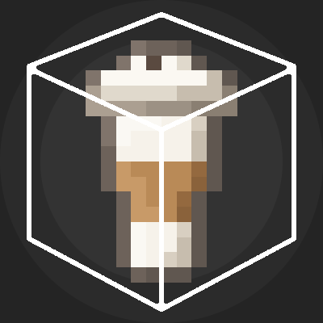

<p align="center"></p>

# Caffeine Cubed

A mod for Minecraft focused on growing, grinding, and brewing coffee. Made for NeoForge, Minecraft 1.21.1.

Needs [Patchouli](https://modrinth.com/project/patchouli) (1.21.1-93 or newer) for its guide book. JEI is optional.

Languages: English, German (`de_de`), Spanish (Spain, `es_es`), Japanese (`ja_jp`) and Korean (`ko_kr`), for every
name, tooltip, message and JEI text. The guide book is in English for now (Patchouli shows it in English in any
language), and other Spanish variants (such as `es_mx`) fall back to English like any missing language.

## Caffeine Cubed Guide

An in-game guide to everything in the mod: a leather-bound book with green tabs, drawn by Patchouli. Craft it from a
**book and a raw coffee bean** (shapeless; JEI shows the recipe) and right-click to read it.

- Six sections: Getting Started, Growing Coffee, Roasting & Grinding, The Coffee Machine, Drinks and The Triple Axis
  Siphon, with an entry for every bean, machine, attachment and drink.
- Machine recipes are shown on the same café-style panels as JEI's pages, the coffee bush and a machine with all three
  attachments as turning 3D models, and crafting recipes in crafting grids. Siphon recipes cycle through the qualities.
- Entries link to each other, and Patchouli adds search, bookmarks and marks entries you haven't read yet.

## Raw Coffee Beans

Plant them on grass or dirt (or farmland) to grow a Coffee Bush, the same way you plant sweet berries.

- Find your first beans by breaking grass and ferns in **jungles**: 1 time in 32, four times rarer than wheat seeds
  (Fortune helps, shears don't drop any). Being from a jungle, they are always Great.
- They can go in a composter.

## Bean Quality

Every bean has a quality, shown in its tooltip. A bush's beans get their quality from the biome the bush grows in;
the quality of the bean you planted doesn't matter.

| Quality | Biomes |
|---|---|
| **Great** (gold) | Jungles: jungle, sparse jungle, bamboo jungle |
| **Good** (green) | Savannas: savanna, savanna plateau, windswept savanna |
| **Decent** (white) | Everywhere else, such as plains, forests, meadows, swamps, deserts, badlands and caves |
| **Poor** (red) | Cold biomes: taigas, snowy and icy biomes, windswept hills, cold mountains, cold and frozen water, the End |

- Beans of different qualities don't stack together. Beans with no quality (from `/give`, or older worlds) are Decent.
- Pick block (middle-click) on a bush gives a bean of the quality that bush grows.
- The creative tab has beans of every quality.
- Which biome grows what is set by three biome tags, so a data pack can move biomes around, including modded ones:
  `caffeinecubed:grows_great_coffee` (`#c:is_jungle`), `caffeinecubed:grows_good_coffee` (`#c:is_savanna`) and
  `caffeinecubed:grows_poor_coffee` (`#c:is_cold`, `#c:is_snowy`, `#c:is_icy`, `#c:is_taiga`). Most modded biomes
  already belong to these `c:` tags. A biome in more than one gets the best quality, and a biome in none grows Decent beans.

## Coffee Bush

Works like a sweet berry bush. It grows through four stages on its own, at the same pace as a sweet berry bush
(it needs light level 9 or more):

1. **Starter bush:** a small bush, just planted.
2. **Bush:** full-sized, no fruit yet.
3. **Fruiting:** green, unripe coffee cherries. They can't be picked yet.
4. **Ripe:** covered in red coffee cherries.

- **Right-click a ripe bush** to pick 1-3 Raw Coffee Beans, of the quality its biome grows. The bush stays where it is and goes back to stage 2,
  ready to fruit again.
- Bone meal grows it one stage at a time.
- Breaking a ripe bush drops 1-3 beans (more with Fortune). Breaking a younger bush drops nothing, like a sweet berry bush.
- Walking through it slows you down, but unlike a sweet berry bush it has no thorns, so it doesn't hurt.
- Bees help it grow, and swords and axes cut it quickly.

## Coffee Roaster

Roasts coffee beans one roast darker, using furnace fuel. Right-click it to open it.

| Put in | Comes out |
|---|---|
| Raw Coffee Beans | Light Roast Coffee Beans |
| Light Roast Coffee Beans | Medium Roast Coffee Beans |
| Medium Roast Coffee Beans | Dark Roast Coffee Beans |

- Dark Roast is as dark as beans go: it can't go back in.
- **Roasting keeps the quality.** Great raw beans come out as Great light roast, and so on. Beans of different roasts
  or qualities don't stack, so the roaster waits while its output slot holds different beans.
- Each bean takes 10 seconds (200 ticks), as long as a furnace takes to smelt something. Fuel only burns while
  beans are roasting, so **one coal always roasts exactly 8 beans**. Any furnace fuel works.
- Laid out like a furnace: beans at the top, fuel below, roasted beans on the right. Shift-clicking sorts beans and fuel
  into their slots.
- Hoppers work like on a furnace: beans in through the top, fuel through the sides, roasted beans out of the bottom.
  Item pipes from other mods work the same way.
- While roasting, smoke curls out of its hopper and it crackles.
- Its front (the door and chute) faces you when you place it. When broken it spills what's inside, like a furnace,
  and a comparator reads how full it is.
- Recipe: a hopper on top, a furnace in the middle and iron ingots around it.

```
. H .
I F I
I . I
```

## Coffee Grinder

A hand tool that grinds roasted beans into grounds.

1. Hold the grinder in your **main hand** and roasted beans in your **off hand**.
2. **Hold right-click.** Every second, one bean is ground into grounds, which go into your inventory (or drop at your
   feet if it's full). It keeps grinding until you let go, run out of beans, or the grinder breaks.

| Off hand | Grinds into |
|---|---|
| Light Roast Coffee Beans | Light Roast Coffee Grounds |
| Medium Roast Coffee Beans | Medium Roast Coffee Grounds |
| Dark Roast Coffee Beans | Dark Roast Coffee Grounds |

- **Grounds keep the beans' quality:** Decent light roast beans make Decent light roast grounds, and so on.
- It has **32 uses**: each bean costs 1 durability, so one grinder makes 32 grounds.
- Raw beans have to be roasted first. Right-clicking without roasted beans in the off hand says so above the hotbar.
- While grinding it rasps and crumbs of bean fly off. In first person it rocks gently with the crank; in third person
  the arm is held out like when brushing.
- Recipe: a stick for the crank, flint for the burrs and iron ingots for the body.

```
. S .
I F I
. I .
```

## Coffee Machine

Brews a cup of **Coffee** from:

- a **Water Bucket**,
- **3 coffee grounds** of the same roast and quality, and
- **furnace fuel** (wood, coal and so on).

Put a block of **Ice** in the water slot instead of the bucket and it brews **Ice Coffee** (see below).

Right-click it to open it. Water, the flame and fuel are on the left; the grounds, an arrow and the cup on the right.
Attachments on the machine add more (see below).

- A cup takes **20 seconds** (400 ticks), twice as long as a furnace. Fuel only burns while it brews, so
  **one coal brews 4 cups**.
- Each cup uses up the water: the **empty bucket stays in the water slot**, so put in a new water bucket for the next cup.
  Ice is used up **one block per cup**, so a stack of ice in the slot brews a cup of Ice Coffee per block.
- The coffee keeps the **quality** of the grounds. Cups only stack with the same kind of coffee of the same quality, so
  the machine waits while its cup slot holds a different one (Coffee when it's brewing Ice Coffee, for example).
- It has two looks: **idle**, and **on** while it brews, with a cup filling under the spout and steam rising from it.
- Its front faces you when you place it. Shift-clicking sorts water, ice, grounds and fuel into their slots.
- Hoppers: grounds in through the top, water buckets, ice and fuel through the sides, coffee and empty buckets out of the
  bottom (ice stays in).
  Item pipes from other mods work the same way. A comparator reads how full it is.
- Recipe: iron ingots around glass panes, a piece of paper (the filter) and a furnace.

```
I I I
G P G
I F I
```

## Coffee Machine attachments

Attachments add abilities to a Coffee Machine. The machine itself looks the same; its interface gains new slots.

### Grinder Attachment

Place it **on top of a Coffee Machine** (it can't go anywhere else, and drops off if the machine underneath is removed).
The machine's interface then shows a **bean slot** next to the grounds, with an arrow into them.

- Roasted beans put in the bean slot are **ground into the grounds slot**, keeping their roast and quality.
- It takes **5 seconds (100 ticks) per bean**, half a furnace's time, and needs **no fuel, water or durability**.
- It grinds while the machine brews, and a cup can be brewed straight from the beans once 3 grounds are ready. Only
  brewing burns fuel.
- It waits while the grounds slot is full or holds grounds of a different roast or quality.
- A hopper on top of the attachment, or at the machine's sides, feeds the bean slot. Item pipes from other mods work too.
- Without the attachment the bean slot disappears; beans left in it stay visible until you take them out.
- Recipe: a hopper over a Coffee Grinder, between two iron ingots.

```
. H .
I G I
```

### Milk Frother

Place it on the **right side of a Coffee Machine**, as seen from the machine's front (it can't go anywhere else). It
turns to face the same way as the machine, its connectors reaching into it, and drops off if the machine is removed.
The machine's interface then shows a **milk slot** in its top right corner.

- **Milk is optional.** Coffee still brews from water, fuel and three grounds. If a **Milk Bucket** is in the milk slot
  when a cup finishes, that cup is made **with milk** and the empty bucket is left in the slot. Milk can be put in any
  time before the cup is done.
- Coffee with milk says "With Milk" in its tooltip and gives **30 seconds of Regeneration I** on top of its usual
  effects. It doesn't stack with coffee without milk.
- A hopper on top of the frother, or at the machine's sides, feeds the milk slot; empty buckets come out of the bottom.
- Without the frother the milk slot disappears, and any milk left in it is ignored until you take it out.
- The frother's layouts leave out the right-hand lamp to make room for the milk slot.
- Recipe: an iron ingot over glass panes around a milk bucket, on three iron ingots. The empty bucket is left in the
  crafting grid.

```
. I .
G M G
I I I
```

### Syrup Compactor

Place it on the **left side of a Coffee Machine**, as seen from the machine's front (it can't go anywhere else). Like
the frother, it faces the same way as the machine and drops off if the machine is removed. The machine's interface
then shows a **syrup slot** in its bottom left corner, diagonally opposite the milk slot.

- **Syrups are optional.** If one of these is in the syrup slot when a cup finishes, **one** is used up and the cup gets
  that syrup, which adds **1 minute** of its effect, at level I:

| Ingredient | Syrup | Effect |
|---|---|---|
| Pufferfish | Pufferfish Syrup | Water Breathing |
| Fermented Spider Eye | Fermented Spider Eye Syrup | Invisibility |
| Golden Carrot | Golden Carrot Syrup | Night Vision |
| Rabbit's Foot | Rabbit's Foot Syrup | Jump Boost |

- A whole stack can sit in the slot; it makes one cup of that syrup per item.
- Syrups and milk combine: a cup can have both, and gives all of its effects. Its tooltip lists "With Milk" and
  "With ... Syrup" under the roast.
- A hopper on top of the compactor, or at the machine's sides, feeds the syrup slot.
- Recipe: a piston over two glass bottles and an iron ingot, on three iron ingots.

```
. P .
B I B
I I I
```

### Attachments together

All three attachments can be on one machine at once: the grinder on top, the frother on the right and the compactor
on the left. The interface has a layout for every combination, showing exactly the slots the attached ones add.
Slots stay visible while they still hold items, even after their attachment is removed, so nothing gets stuck.

## Coffee

A takeaway cup of coffee with a lid, brewed in the Coffee Machine. It remembers the **roast** and **quality** of the
grounds it was brewed from, and its tooltip lists both along with what drinking it does. Stacks to 16; cups only stack
with the same roast and quality.

**Drink it** (hold right-click, as long as a potion takes) to use up the cup and get:

| Quality | Speed I |
|---|---|
| Poor | 1:00 |
| Decent | 2:00 |
| Good | 3:00 |
| Great | 4:00 |

plus one minute of an effect from the roast:

| Roast | Effect |
|---|---|
| Light | Slow Falling I (1:00) |
| Medium | Haste I (1:00) |
| Dark | Strength I (1:00) |

Coffee brewed with milk (from a Milk Frother) also gives 30 seconds of Regeneration I, and coffee with a syrup (from a
Syrup Compactor) a minute of the syrup's effect: Water Breathing, Invisibility, Night Vision or Jump Boost.

For example, a cup of Medium Roast, Decent coffee gives 2:00 of Speed I and 1:00 of Haste I. Coffee can be drunk at
any time, hungry or not, and nothing is handed back. Drinking another cup while an effect is still running keeps
whichever lasts longer, as with potions. A Coffee with no roast recorded (for example from `/give`) counts as Medium Roast.

## Ice Coffee

Coffee brewed with a block of **Ice** in the machine's water slot instead of a water bucket, served in a clear cup with
a straw. It is made the same way and works the same way as Coffee: it keeps the grounds' roast and quality, takes milk
and syrups, stacks to 16 and has the same tooltip. The one difference is its base effect, **Fire Resistance I** instead
of Speed I, for as long as the quality allows:

| Quality | Fire Resistance I |
|---|---|
| Poor | 1:00 |
| Decent | 2:00 |
| Good | 3:00 |
| Great | 4:00 |

plus the same roast effect, and Regeneration from milk and a syrup's effect as above. For example, a Dark Roast, Great
Ice Coffee with milk and Pufferfish Syrup gives 4:00 of Fire Resistance, 1:00 of Strength, 0:30 of Regeneration and
1:00 of Water Breathing. Ice Coffee and Coffee don't stack with each other.

Only plain Ice works; Packed Ice, Blue Ice and snow don't go in the water slot.

## Triple Axis Siphon

The last machine: it slowly draws three ingredients together into one, each in its own slot. Right-click it to open it. Laid out like the
siphon itself, it has an input slot on the left, one on top and one on the right, each with an arrow pointing into the
gold-framed slot in the middle, where the result comes out.

| Ingredients | Makes |
|---|---|
| 1 Light Roast, 1 Medium Roast and 1 Dark Roast Coffee Grounds | Rainbow Blend |
| 3 Rainbow Blend, a Water Bucket and an Enchanted Golden Apple | God's Coffee |
| 3 Rainbow Blend, a block of Ice and an Enchanted Golden Apple | God's Ice Coffee |

- Grounds and blends must all be of the **same quality**, and what's made keeps it: Great grounds make a Great Rainbow
  Blend, and Great Rainbow Blends make a Great God's Coffee.
- The three go in **any order**, one ingredient per slot (the three Rainbow Blends stack in one slot): a slot won't take
  something that's already in another slot, that doesn't go with what's there, or of a different quality.
- The water bucket leaves its **empty bucket** in its slot, as in the Coffee Machine; take it out (or let a hopper
  underneath) before the next one. Ice is used up one block at a time.
- It takes **40 seconds** (800 ticks), four times as long as a furnace, and needs **no fuel**. The three arrows fill
  towards the middle together, in the colours of the rainbow.
- Taking an input out starts the blend over. It waits while the output holds something it can't stack with.
- Its front faces you when you place it, so its arms reach out to your left and right.
- Hoppers: each arm takes from a hopper on its own side, the top from a hopper above, and what it makes and empty
  buckets come out of the bottom. A hopper at the front or back fills whichever slot the ingredient fits. Item pipes from other mods work the
  same way. A comparator reads how full it is.
- Shift-clicking ingredients puts each into a slot of its own.
- Recipe: a gold ingot over gold ingots around a nether star, on three blocks of quartz.

```
. G .
G S G
Q Q Q
```

## Rainbow Blend

Light, medium and dark roast grounds drawn together in the Triple Axis Siphon, keeping their quality like everything
else made from beans. Three of them go into God's Coffee. Stacks to 64.

## God's Coffee

The mod's top tier coffee, made in the Triple Axis Siphon from three Rainbow Blends, a water bucket and an enchanted
golden apple, in a cup with a gold lid and a rainbow sleeve. Like an enchanted golden apple it has a purple name and
the enchantment glint. Drink it like any other coffee (the cup is used up) to get **six effects at once**, all for
the same time, which depends on its quality:

| Quality | Every effect lasts |
|---|---|
| Poor | 0:30 |
| Decent | 1:00 |
| Good | 1:30 |
| Great | 2:00 |

The effects are **Speed II**, Regeneration I, Night Vision, Resistance I, Strength I and Haste I. It has no roast, milk
or syrup. Stacks to 16, and only with the same quality.

**God's Ice Coffee** is made the same way with a block of ice instead of the water bucket, in a clear cup with a gold
lid and straw and rainbow coffee. It is the same in every way, except that **Fire Resistance** replaces Speed II.

## Config

Each world, and each server, has its own settings in `serverconfig/caffeinecubed-server.toml` inside the world's folder.
A server sends its settings to the players who join, so their machine screens, JEI pages and drink tooltips match the
server. In singleplayer they can also be changed in-game: **Mods → Caffeine Cubed → Config**. A modpack can set the
starting settings for new worlds by putting the file in `defaultconfigs/`.

| Setting | Default | What it does |
|---|---|---|
| `growing.jungleGrassBeanChance` | 0.03125 (1 in 32) | Chance that jungle grass or ferns drop a raw bean |
| `machines.roastingTime` | 200 ticks | Coffee Roaster, per bean |
| `machines.handGrindingTime` | 20 ticks | Coffee Grinder, per bean |
| `machines.brewingTime` | 400 ticks | Coffee Machine, per cup |
| `machines.attachmentGrindingTime` | 100 ticks | Grinder Attachment, per bean |
| `machines.siphoningTime` | 800 ticks | Triple Axis Siphon, per result |
| `drinks.baseEffectSecondsPoor` / `Decent` / `Good` / `Great` | 60 / 120 / 180 / 240 | Speed (or Fire Resistance) from Coffee (or Ice Coffee) |
| `drinks.roastEffectSeconds` | 60 | Slow Falling, Haste or Strength from the roast |
| `drinks.milkRegenerationSeconds` | 30 | Regeneration from milk |
| `drinks.syrupEffectSeconds` | 60 | A syrup's effect |
| `drinks.godsCoffeeSecondsPoor` / `Decent` / `Good` / `Great` | 30 / 60 / 90 / 120 | Every effect of God's Coffee and God's Ice Coffee |

20 ticks is one second, and machines that burn fuel still only burn it while working, so a coal lasts 1600 ticks of
work. Setting an effect's seconds to 0 turns that effect off. The guide book and this README describe the defaults.

## Recipes and data packs

What the Coffee Roaster, Coffee Grinder (and Grinder Attachment), Coffee Machine and Triple Axis Siphon make are
recipes, JSON files like vanilla's, so a data pack can add, change or remove them. The mod's own are in
`data/caffeinecubed/recipe/`: `roasting/`, `grinding/`, `brewing/` and `siphoning/`, three of each. A file at the same
path in a data pack replaces one; to remove one, put `{"neoforge:conditions": [{"type": "neoforge:false"}]}` there.
Players' games get the server's recipes when they join, and JEI shows whatever the recipes are. An ingredient can be an
item (`{"item": ...}`) or a tag (`{"tag": ...}`).

Quality works the same for every recipe: the result keeps the quality of what went in, if the result has one.

**Roasting** and **grinding** turn one item into another, one at a time:

```json
{
  "type": "caffeinecubed:roasting",
  "ingredient": { "item": "caffeinecubed:raw_coffee_beans" },
  "result": { "id": "caffeinecubed:light_roast_coffee_beans" }
}
```

(`caffeinecubed:grinding` looks the same.) **Brewing** says which grounds the Coffee Machine takes, how many make a cup
(`count`, 3 if left out) and which roast the cup is (`light`, `medium` or `dark`, which decides its roast effect). The
cup is always Coffee, or Ice Coffee with ice, with milk and syrups added as usual:

```json
{
  "type": "caffeinecubed:brewing",
  "grounds": { "item": "caffeinecubed:light_roast_coffee_grounds" },
  "count": 3,
  "roast": "light"
}
```

**Siphoning** takes one to three ingredients, each going in its own input slot in any order, with how many of each it
uses (`count`, 1 if left out). Ingredients that have a quality must all share it. A water bucket leaves its empty
bucket behind, as any item with a crafting remainder does:

```json
{
  "type": "caffeinecubed:siphoning",
  "ingredients": [
    { "ingredient": { "item": "caffeinecubed:rainbow_blend" }, "count": 3 },
    { "ingredient": { "item": "minecraft:water_bucket" } },
    { "ingredient": { "item": "minecraft:enchanted_golden_apple" } }
  ],
  "result": { "id": "caffeinecubed:gods_coffee" }
}
```

How long each machine takes is in the config, not the recipes. The crafting-table recipes for the machines, the
grinder and the guide book are ordinary vanilla recipes in `data/caffeinecubed/recipe/`.

## Sounds and light

Each machine sounds like what it does while it works, and glows as brightly as a lit furnace (light level 13), going
dark again when it stops.

| Machine | While working |
|---|---|
| Coffee Roaster | Crackles like a lit furnace (the furnace's own sound, just as often) and smokes |
| Coffee Grinder, Grinder Attachment | The grindstone's sound (no light: the grinder is held, and the attachment's machine only lights up to brew) |
| Coffee Machine | Its own brewing sound, 20 seconds long like a cup, looping cup after cup and stopping as soon as brewing stops; steam rises from the cup |
| Triple Axis Siphon | Hums like a beacon, every 4 seconds like a beacon; a brewing stand's bubble when something is done |

## JEI

When JEI is installed (it's optional):

- A **Coffee Roasting** page shows each roast step, styled like the roaster. Its slots cycle through the qualities
  together, showing Great beans roasting into Great beans and so on. Hovering the flame explains the fuel, and the
  arrow that quality is kept.
- A **Coffee Grinding** page in the same style shows beans, the grinder and the grounds they make. The slots' tooltips
  say which hand each goes in, and the grinder's that it uses 1 durability per bean.
- A **Coffee Brewing** page shows the water, three grounds and the cup they brew, with tooltips for the water, the fuel
  and the quality, and each recipe again with milk, with each syrup, and with both, showing the Milk Bucket and the
  syrup's ingredient. All of those are listed again with ice in place of the water, brewing Ice Coffee. Clicking the
  Coffee Machine's arrow opens it, and the Milk Frother and Syrup Compactor are listed beside it.
- A **Triple Axis Siphon** page shows each of its recipes, with the ingredients that have a quality and the result
  cycling through the qualities together. Hovering an arrow says it needs no fuel and that the qualities must match,
  and the water bucket's tooltip that it leaves its bucket behind. Clicking any
  of the siphon's arrows opens it.
- Every quality of every roast of beans and grounds is its own entry in JEI's list, and looking one up shows how it's
  made and what it turns into.
- The Coffee Roaster is listed as the machine for roasting and on JEI's fuel page. Clicking the arrow in the roaster
  opens its recipes, and JEI's [+] button moves beans from your inventory into it.

## License

Caffeine Cubed is under the [MIT License](LICENSE): anyone may use, copy, change and share it, in their own projects
and modpacks too, as long as the license and copyright notice come along. The one exception is the Coffee Machine's
brewing sound, which keeps its own license (below).

## Credits

- Coffee Machine brewing sound: a modified version of
  ["Coffee machine (SoundAction 024)"](https://freesound.org/s/721706/) by alexarje, licensed under
  [CC BY 4.0](https://creativecommons.org/licenses/by/4.0/).

## Development

- Build: `gradlew build` (needs JDK 21; the jar ends up in `build/libs`).
- Play in a dev client: `gradlew runClient`. Gradle downloads JEI and Patchouli for it (`jei_version` and
  `patchouli_version` in `gradle.properties`), so nothing needs to be put in `run/mods`. The JEI code is in `compat/jei`
  and only loads when JEI does.
- The Blockbench projects for every model are in `blockbench/`; export a model from there and change only its texture
  path (and add the cutout render type) to update it.
- Game tests: `gradlew runGameTestServer`, or `/test runall` in a dev client.
- Textures: `python tools/generate_assets.py` draws any texture that doesn't exist yet (needs Pillow). It never
  overwrites, so hand-drawn textures are safe; delete one to have it redrawn.
- The guide is a Patchouli book. `data/caffeinecubed/patchouli_books/guide/book.json` sets its look (our own item,
  `caffeinecubed:guide_book`, is the book); its sections, entries and recipe-page templates are JSON files under
  `assets/caffeinecubed/patchouli_books/guide/en_us`, so its wording can be edited directly. The mod compiles against
  Patchouli from the BlameJared maven (`patchouli_version` in `gradle.properties`), and the jar to play with in dev is in
  `run/mods`.
- The guide's book texture (`textures/gui/book/guide.png`) is drawn entirely by `generate_assets.py`, in the layout
  Patchouli reads a book texture in: the book and its name ribbon, and every button and icon (cream, gold under the
  mouse) in the spot Patchouli takes it from.
- The Coffee Roaster's model and texture are made in Blockbench (`CoffeeRoaster.bbmodel`, kept outside the project).
  The exported model is `models/block/coffee_roaster.json` with only its texture path changed to
  `caffeinecubed:block/coffee_roaster` and a cutout render type added. The model's front faces west; the blockstate turns it.
  Its item model (`models/item/coffee_roaster.json`) shows it the way the other machines' items are shown, a full
  block's views turned a quarter so its front faces where theirs do; the views set in Blockbench aren't used.
- The Coffee Machine's two models are made in Blockbench (`coffeemachine.bbmodel` and `coffeemachineon.bbmodel`), each
  with its own texture. They are `models/block/coffee_machine.json` and `coffee_machine_on.json`, with their texture
  paths changed to `caffeinecubed:block/coffee_machine` and `coffee_machine_on` and a cutout render type added. Both
  face north, like a furnace's. The item model borrows a full block's display settings, since the block models have none.
- The Grinder Attachment's model is made in Blockbench (`grinderattachment.bbmodel`): `models/block/grinder_attachment.json`,
  with its texture path changed to `caffeinecubed:block/grinder_attachment` and a cutout render type added. Its item
  model borrows a full block's display, raised and enlarged a little in the inventory.
- The Milk Frother's model is made in Blockbench (`milkfrother.bbmodel`): `models/block/milk_frother.json`, with its
  texture path changed to `caffeinecubed:block/milk_frother` and a cutout render type added. It faces north like the
  machine, with its connectors reaching east past the edge of its block into the machine.
- The Syrup Compactor's model is made in Blockbench (`syrupcompactor.bbmodel`): `models/block/syrup_compactor.json`,
  with its texture path changed to `caffeinecubed:block/syrup_compactor` and a cutout render type added. It faces north
  like the machine, with its connectors reaching west past the edge of its block into the machine.
- The Triple Axis Siphon's model is made in Blockbench (`tripleaxissiphon.bbmodel`):
  `models/block/triple_axis_siphon.json`, with its texture path changed to `caffeinecubed:block/triple_axis_siphon` and
  a cutout render type added. Its arms reach east and west, so facing north they are to the left and right of whoever
  placed it. Its recipes are listed in `SiphonRecipe`.
- The Coffee Grinder's model and texture are also made in Blockbench (`coffeegrinder.bbmodel`). The exported model is
  `models/item/coffee_grinder.json`, with its texture path changed to `caffeinecubed:item/coffee_grinder`. Its views
  are the machines' (a full block's, turned a quarter like the roaster's, crank side where their fronts are), sized up
  for its small model: 0.9 in the inventory, 0.45 in first person, 0.55 in third person, 0.4 on the ground and 0.75 in
  item frames.
